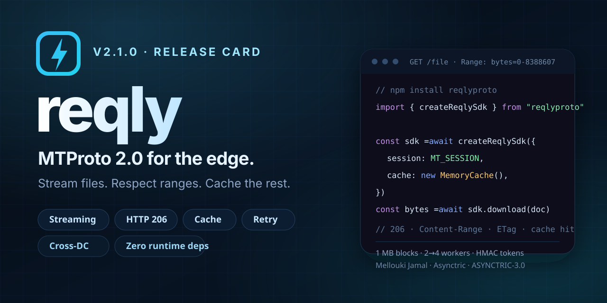
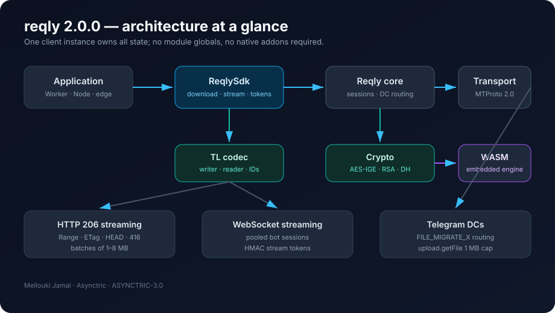

<div align="center" dir="rtl">


**عميل MTProto 2.0 صغير للطلب/الرد، مصمّم لـ Cloudflare Workers وبيئات الحافة.**

[](https://www.npmjs.com/package/reqlyproto)
[](https://www.npmjs.com/package/reqlyproto)
[](https://github.com/JamalMellouki/reqly-mtproto/releases)
[](https://github.com/JamalMellouki/reqly-mtproto/actions/workflows/ci.yml)
[](./LICENSE)
[](./package.json)

[البداية السريعة](#-البداية-السريعة) · [SDK](#-sdk-عالي-المستوى) · [الكاش وإعادة المحاولة](#-الكاش-وإعادة-المحاولة) · [Worker](#-معالج-worker-بنداء-واحد) · [التوثيق](#-التوثيق) · [English](./README.md)

</div>



> **الإصدار 2.1.0 — كاش، متانة، ومسار أوضح.**
> نفس العميل الصغير، مع كاش بايتات آمن المرجع، وسياسة إعادة محاولة جاهزة،
> وإصلاح تدفّق تحديث المرجع في `sdk.download()`، ومجموعة توثيق تأخذك من
> سلسلة جلسة إلى Worker جاهز للنشر ودعم النطاقات.

## المحتويات

- [الجديد في 2.1.0](#-الجديد-في-210)
- [لماذا reqly؟](#-لماذا-reqly)
- [المزايا في لمحة](#-المزايا-في-لمحة)
- [المعمارية](#-المعمارية)
- [التثبيت](#-التثبيت)
- [البداية السريعة](#-البداية-السريعة)
- [SDK عالي المستوى](#-sdk-عالي-المستوى)
- [الكاش وإعادة المحاولة](#-الكاش-وإعادة-المحاولة)
- [معالج Worker بنداء واحد](#-معالج-worker-بنداء-واحد)
- [مرجع الواجهة](#-مرجع-الواجهة)
- [الأخطاء](#-الأخطاء)
- [التنزيل عبر مراكز البيانات](#-التنزيل-عبر-مراكز-البيانات)
- [الأداء](#-الأداء)
- [الأمان](#-الأمان)
- [التوثيق](#-التوثيق)
- [التطوير](#-التطوير)
- [الترخيص](#-الترخيص)

## ✨ الجديد في 2.1.0

| | |
|---|---|
| **🧠 `MemoryCache`**<br>كاش LRU بميزانية بايتات وTTL وعدّادات وقراءات آمنة النسخ، بلا تبعيات. | **🌐 `createCacheApiStore()`**<br>يحوّل واجهة `Cache` القياسية إلى عقد كاش الـ SDK بسطر واحد. |
| **🔁 `withRetry()`**<br>سياسة إعادة محاولة مع تراجع أسي وjitter وامتصاص `FLOOD_WAIT` ودعم الإلغاء. | **🩹 إصلاحات SDK**<br>`download()` يمرّر `refresh`، ويقرأ عبر الكاش، ويعرض تقدّماً متصاعداً. |
| **🌍 `sdk.worker()`**<br>يرث جلسة الـ SDK وخيارات الاتصال بدل بدء جلسة فارغة. | **🔑 مفاتيح آمنة المرجع**<br>`ReqlySdk.cacheKey()` يبصم `file_reference`، فلا تخدم بايتات قديمة مستنداً محدّثاً. |
| **📚 أدلة جديدة**<br>البداية، كتاب الوصفات، مرجع الواجهة، الأسئلة الشائعة، وسياسة أمان. | **🖼️ هوية جديدة**<br>شعار وبطاقة إصدار، وREADME أنظف، وتوحيد 2.1.0 في كل مكان. |

## 🚀 لماذا reqly؟

مكتبات MTProto الكاملة صُمّمت لعمليات طويلة الأمد: تبقي المقابس وحلقات التحديث
ومجمّعات الاتصال مفتوحة، وتجرّ خرائط TL ضخمة إلى الحزمة. على Workers يعني ذلك
بدءاً بطيئاً واستهلاكاً عالياً لـ CPU. تُبقي reqly على الحد الأدنى المطلوب
للملفات فقط:

- تحليل جلسات gramJS (`StringSession` v1)،
- تشفير رسائل MTProto 2.0 واشتقاق المفاتيح،
- نقل WebSocket مُعمّى (abridged)،
- codec صغير للـ Type Language،
- طبقة نطاقات HTTP تفهم `206` و`Content-Range` و`ETag` و`HEAD`.

**بدون تبعيات وقت تشغيل، بدون وحدات أصلية، وبدون حالة مشتركة بين الطلبات.**

## 🧩 المزايا في لمحة

| | |
|---|---|
| **⚡ أصلية للحافة**<br>صفر تبعيات، بلا وحدات أصلية، وحالة لكل نسخة. آمنة لـ Workers المتزامنة. | **🔁 وضعا نقل**<br>اتصال واحد معاد الاستخدام لكل DC، أو مقبس جديد لكل RPC لعزل تام. |
| **📦 بث النطاقات**<br>`Range` و`206` و`Content-Range` و`ETag` و`HEAD` و`416`، بدفعات 1–8MB و2→4 عمّال. | **🧭 جاهز لعبر المراكز**<br>تبادل مفاتيح RSA/DH كامل داخلياً، وإعادة المحاولة على المركز الصحيح. |
| **🔐 توكنات بث موقّعة**<br>توكنات HMAC-SHA256 قصيرة العمر بين العمال. | **🧩 تشفير قابل للتوصيل**<br>AES-256-IGE بـ TypeScript، أو WASM مدمج، أو مزوّد مخصص. |
| **🪙 SDK عالي المستوى**<br>`download()` و`range()` و`stream()` و`hashes()` و`worker()` باستيراد واحد. | **🧪 قياس لا تقدير**<br>سكربت قياس قابل للتكرار وأرقام حقيقية في [`docs/BENCHMARKS.md`](./docs/BENCHMARKS.md). |
| **🧠 كاش بايتات**<br>كاش LRU في الذاكرة أو Cache API، بمفاتيح آمنة المرجع. | **🔁 سياسة إعادة محاولة**<br>تراجع وjitter و`FLOOD_WAIT` وإلغاء في مساعد واحد. |

## 🏗️ المعمارية



كل طبقة قابلة للاستبدال، وكل حالة تعيش داخل نسخة العميل: عدّادات `msg_id`
والجلسات والاتصالات لا تصبح متغيرات عامة. التفاصيل في
[`docs/ARCHITECTURE.md`](./docs/ARCHITECTURE.md).

## 📦 التثبيت

```sh
npm install reqlyproto
```

الحزمة ESM، وتشحن تعريفات TypeScript الخاصة بها، و**بدون أي تبعية وقت تشغيل**.

## ⚡ البداية السريعة

```ts
import { Reqly, TlWriter } from "reqlyproto"

const client = await Reqly.connect(env.MT_SESSION)

// أي طريقة MTProto تُستدعى بكتابة معرّف الباني وحقوله.
const config = await client.invoke(new TlWriter().uint(0xc4f9186b).result())
```

### تنزيل ملف من Telegram

```ts
import { Reqly } from "reqlyproto"

const client = await Reqly.connect(sessionString)

// المفضّل: محاذاة الكتل ومراجع الملفات والهجرة ونهاية الملف تُعالَج تلقائياً.
const bytes = await client.getFile(
  { id, accessHash, fileReference, size },
  offset,
  limit,
)

client.close()
```

## 🪙 SDK عالي المستوى

مضمّن داخل الحزمة نفسها (لا حزمة إضافية):

```ts
import { createReqlySdk, ReqlySdk } from "reqlyproto"

const sdk = await createReqlySdk({
  session: MT_SESSION,          // سر Worker — لا يوضع في الشيفرة
  dcSessions: DC_SESSIONS,      // اختياري، لـ FILE_MIGRATE_X
  tokenSecret: STREAM_SECRET,   // اختياري، لـ issueToken()/verifyToken()
})

const bytes  = await sdk.download(document, { onProgress: (done, total) => {} })
const part   = await sdk.range(document, 0, 512 * 1024 - 1)
const stream = sdk.stream(document, { chunkSize: 512 * 1024 })
const hashes = await sdk.hashes(document)
const token  = await sdk.issueToken({ m: messageId, w: "work-1", k: "stream" }, 60)

sdk.close()
```

العميل الخام يبقى على بعد خاصية واحدة: `sdk.client.invoke(methodBytes)`.

الدليل الكامل: [`docs/SDK.md`](./docs/SDK.md).

## 🧠 الكاش وإعادة المحاولة

### كاش البايتات

```ts
import { createReqlySdk, MemoryCache, createCacheApiStore } from "reqlyproto"

// Node أو الاختبارات أو عملية طويلة العمر:
const cache = new MemoryCache({ maxBytes: 32 * 1024 * 1024, ttlSeconds: 3600 })

// Cloudflare Workers أو المتصفح:
const edgeCache = createCacheApiStore(caches.default, 3600)

const sdk = await createReqlySdk({ session: MT_SESSION, cache: edgeCache })
const bytes = await sdk.download(document)   // النداء الثاني يُخدم من الكاش
```

مفاتيح الكاش تشمل معرّف المستند وaccess hash و**بصمة `file_reference`**
والإزاحة والطول، فلا يمكن لمرجع محدّث أن يعيد استخدام بايتات قديمة.

تُخزَّن الكتلة فقط عندما تكون كاملة؛ القراءات القصيرة في منتصف الملف تُهمَل
حتى لا تسمّم المواضع اللاحقة.

### سياسة إعادة المحاولة

```ts
import { withRetry, isRetryableError } from "reqlyproto"

const entries = await withRetry(() => sdk.hashes(document), {
  retries: 3,
  baseDelayMs: 150,
  maxDelayMs: 4_000,
  jitter: 0.2,
  respectFloodWait: true,
  signal: request.signal,
})

isRetryableError(new Error("reqly: RPC timed out"))   // true
isRetryableError(new Error("FILE_REFERENCE_EXPIRED")) // false — يحتاج تحديثاً
```

تُعاد المحاولة عند أعطال النقل العابرة و`429` و`5xx` و`FLOOD_WAIT`. أما أخطاء
الملفات (`FILE_REFERENCE_EXPIRED` و`FILE_MIGRATE_X`) فتُعالَج بمسارات صريحة
داخل العميل، لا بتكرار أعمى.

## ☁️ معالج Worker بنداء واحد

```ts
import { createWorkerHandler } from "reqlyproto"

export default createWorkerHandler({
  session: MT_SESSION,
  connectOptions: { dcSessions: DC_SESSIONS },
  resolveDocument: () => document,
  maxWorkers: 4,        // قراءات Telegram متوازية بحجم 1MB
  maxInFlight: 8,       // حد أقصى للقراءة المسبقة
  cache: false,         // فعّلها فقط إذا كانت طلبات الكاش مقبولة
})
```

يضيف المعالج `Range` و`206` و`Content-Range` و`Accept-Ranges` و`ETag`
و`HEAD` و`416` تلقائياً. للتحكم الأدنى استخدم `streamFileRange` أو
`createFileResponse` أو `createFileRequestHandler`.

### الخيارات

| الخيار | الغرض |
| --- | --- |
| `apiId` | معرّف Telegram من my.telegram.org (الافتراضي `1`). |
| `dcSessions` | خريطة `dcId → جلسة` لـ `FILE_MIGRATE_X`. |
| `freshSocket` | `true` يفتح مقبساً لكل RPC؛ `false` (الافتراضي) يعيد استخدام اتصال لكل DC. |
| `timeoutMs` | مهلة RPC بالمللي ثانية. |
| `address`, `port` | تجاوز عنوان ومنفذ المركز من الجلسة. |
| `cdnSupported` | طلب `upload.fileCdnRedirect` عند توفّره. |
| `cache` | كاش `SdkCache` افتراضي لـ `download` و`range` و`stream`. |
| `retry` | سياسة إعادة محاولة افتراضية للمساعدات وقراءات الكتل. |

## 📚 مرجع الواجهة

| التصدير | الغرض |
| --- | --- |
| `createReqlySdk(options)` / `ReqlySdk` | تنزيل ونطاق وبث وتحقق وتوكنات ومعالج Worker |
| `ReqlySdk.cacheKey(document, offset, length)` | مفتاح كاش آمن المرجع لنطاق مستند |
| `MemoryCache` / `createCacheApiStore` | كاشات بايتات جاهزة (LRU وCache API) |
| `withRetry` / `isRetryableError` / `retryDelayMs` | سياسة إعادة محاولة وتصنيف وتأخيرات محدودة |
| `Reqly.connect(session, options?)` | إنشاء عميل من سلسلة جلسة |
| `client.invoke(methodBytes)` | إرسال طريقة TL خام وإرجاع الرد |
| `client.getMessages(...)` | استخراج مراجع الملفات من قناة |
| `client.getFile(...)` | تنزيل مقطع (محاذاة كتل ونهاية ملف آمنة) |
| `client.getFilesParallel(...)` | تجمع متوازٍ متكيّف (2→4 مع تراجع) |
| `client.getFileHashes(...)` | `upload.getFileHashes` مع تحديث المرجع وهجرة المركز |
| `ChunkReader` / `createChunkReader` | قارئ نطاقات مُخزَّن بمحاذاة الكتل وقراءة مسبقة |
| `client.close()` | إغلاق كل الاتصالات القابلة لإعادة الاستخدام |
| `Connection` | اتصال MTProto منخفض المستوى |
| `SessionStore` | سجل جلسات لكل مركز |
| `parseSession(encoded)` | تحليل `StringSession` v1 من gramJS |
| `TlWriter`, `TlReader` | ترميز Type Language |
| `extractDocuments`, `decodeFile` | مساعدات ردود Telegram |
| `setIgeProvider(provider)` | استبدال تشفير AES-256-IGE |
| `deriveKeys`, `messageKeyOf`, `ctrTransform` | بدائيات بروتوكول للاستخدام المتقدم |

المرجع الكامل: [`docs/API.md`](./docs/API.md).

## ⚠️ الأخطاء

- **`FileReferenceExpiredError`** — حدّث المرجع ثم مرّر دالة تحديث إلى `getFile`:

  ```ts
  const bytes = await client.getFile(location, offset, limit, async () => {
    const [document] = await client.getMessages(channelId, accessHash, [messageId])
    return document
  })
  ```

- **`FileMigrateError`** — يكشف `dcId`؛ وفّر `dcSessions` لإعادة المحاولة تلقائياً.
- **`FloodWaitError`** — يكشف `seconds`؛ و`withRetry` يمتصّ الانتظارات الصغيرة.
- **`CdnRedirectError`** — يكشف حمولة إعادة التوجيه عند تفعيل `cdnSupported`.
- بقية الأخطاء `RpcError` بالرمز الرقمي.

## 🧭 التنزيل عبر مراكز البيانات

مفتاح `auth_key` لا يُعاد استخدامه في مركز آخر، لذا يتطلب `FILE_MIGRATE_X`
جلسة مصرّحاً بها للمركز الهدف. تُنفّذ reqly تبادل مفاتيح MTProto 2.0 بالكامل
داخلياً — دون أي مكتبة MTProto أخرى:

- `src/dh.ts` — صيغة السلك الصريحة (`req_pq_multi`، `resPQ`، تحليل pq، إلخ).
- `src/handshake.ts` — RSA_PAD وAES المؤقت ورياضيات DH واشتقاق المفاتيح.
- `src/rsa.ts` — مفاتيح Telegram الإنتاجية الرسمية، متحقَّقة البصمة.

العمل الثقيل (RSA/DH) يُنفَّذ **مرة واحدة في Node**، لا داخل Worker:

```sh
tsx scripts/gen-dc-sessions.ts   # يطبع DC1_SESSION / DC2_SESSION / DC3_SESSION
```

لكل مركز يُنفّذ السكربت المصافحة الكاملة على عنوان TCP الخام، ويُسلسل المفتاح
الجديد إلى `StringSession` متوافق مع gramJS، ثم يصدّر تفويض البوت من المركز
الأم ويستورده على المفتاح الجديد. تُحقن السلاسل عبر
`Reqly.connect(session, { dcSessions })` وتُخزَّن في `SessionStore`.

التغطية في `tests/dh.test.ts` و`tests/handshake.test.ts` و
`tests/handshake-wire.test.ts` و`tests/rsa-key.test.ts`، و
`tests/migrate-live.test.ts` يتحقق من التنزيل عبر المراكز عند
`REQLY_LIVE_TEST=1`.

## 📈 الأداء

الحد الأقصى لـ `upload.getFile` هو 1MB لكل استدعاء. المحرك الافتراضي
TypeScript نقي ولا يحتاج أصلاً خارجياً. على البيئات الضيقة CPU يمكن تسجيل
مزوّد AES-256-IGE مخصّص:

```ts
import { enableWasmCrypto } from "reqlyproto"
enableWasmCrypto(aesWasmModule)   // اختياري: نسخة مسبقة البناء في dist/
```

تُشحن وحدة WASM مسبقة البناء في `dist/aes-ige.wasm` وتُحمّل تلقائياً عند
توفّرها؛ ويمكنك تمرير وحدتك عبر `enableWasmCrypto()`.

تجميع عدة استدعاءات في استجابة HTTP واحدة (2–8MB) يقلّل عدد الطلبات: ملف
2GB بحجم 8MB للاستجابة يحتاج ~250 طلباً — نحو **0.25%** من حد
100,000 طلب/يوم. النطاقات المتكررة تُخدم من Cache API دون الاتصال بـ Telegram.
هذه تقديرات تخطيطية؛ الأرقام المقاسة في
[`docs/BENCHMARKS.md`](./docs/BENCHMARKS.md).

عدّادات `msg_id` لكل نسخة، فلا تتصادم استدعاءات Workers المتزامنة.

## 🔐 الأمان

سلسلة الجلسة تحتوي مفتاح تفويض 2048-بت. عاملها ككلمة مرور: خزّنها كسر Worker،
ولا تضعها في المصدر أو في رابط.

reqly لا تكشف الجلسة أو مفتاح التفويض أو كوكيز Telegram للمستدعين. أخطاء النقل
وأخطاء RPC تُظهر كاستثناءات عادية. توكنات البث موقّعة بـ HMAC-SHA256 وقصيرة
العمر. كل الأمثلة تقرأ الأسرار من متغيرات البيئة.

راجع [`SECURITY.md`](./SECURITY.md) لسياسة الإبلاغ وقائمة التحقق الأمنية.

## 🗂️ التوثيق

- [`docs/GETTING_STARTED.md`](./docs/GETTING_STARTED.md) — من سلسلة جلسة إلى أول تنزيل وWorker
- [`docs/SDK.md`](./docs/SDK.md) — دليل SDK: تنزيل، نطاق، بث، كاش، إعادة محاولة، توكنات
- [`docs/COOKBOOK.md`](./docs/COOKBOOK.md) — وصفات عملية لأحمال الحافة
- [`docs/API.md`](./docs/API.md) — مرجع تصدير بتصدير
- [`docs/ARCHITECTURE.md`](./docs/ARCHITECTURE.md) — مخططات SVG وMermaid وحدود الثقة
- [`docs/BENCHMARKS.md`](./docs/BENCHMARKS.md) — قياسات قابلة للتكرار وJSON خام
- [`docs/PERFORMANCE.md`](./docs/PERFORMANCE.md) — نموذج CPU لـ Worker المنشور
- [`docs/FAQ.md`](./docs/FAQ.md) — أجوبة قصيرة للأسئلة المتكررة
- [`docs/showcase/index.html`](./docs/showcase/index.html) — عرض تفاعلي آمن دون اتصال
- [`docs/RELEASE_2.1.0.md`](./docs/RELEASE_2.1.0.md) — عرض إصدار 2.1.0
- [`CHANGELOG.md`](./CHANGELOG.md) — سجل الإصدارات الكامل

## 🛠️ التطوير

```sh
npm install
npm run build
npm test
```

تغطي الاختبارات AES واشتقاق مفاتيح MTProto وتحليل الجلسات وcodec TL وبث
النطاقات والكاش وإعادة المحاولة. اختبار Telegram الحي متاح لكنه متخطى افتراضياً:

```sh
REQLY_LIVE_TEST=1 REQLY_SESSION="<StringSession>" npm test
```

متغيرات حية اختيارية:

- `REQLY_SESSION` — مطلوب لكل الاختبارات الحية
- `REQLY_DOCUMENT` — JSON بحقول `id`, `accessHash`, `fileReference` (hex), `size`
- `REQLY_DC1_SESSION` … `REQLY_DC5_SESSION` — جلسات اختبارات المراكز
- `REQLY_MIGRATED_DOCUMENTS` — مصفوفة JSON لمستندات اختبار الهجرة

## 📄 الترخيص

ASYNCTRIC-3.0 — استخدام وتعديل وتوزيع حر للأغراض الشخصية والتجارية، بشرط
الحفاظ على هوية المؤلف **Mellouki Jamal** والمنصة **Asynctric** في المصدر
والتوثيق. تضاف في النسخة 3.0 بنود صريحة لعدم الضمان وتحديد المسؤولية.
راجع [`LICENSE`](./LICENSE).

---

<div align="center" dir="rtl">

**صنعه Mellouki Jamal لمنصة Asynctric.**

`reqly` · `reqlyproto` · الإصدار **2.1.0**

</div>
