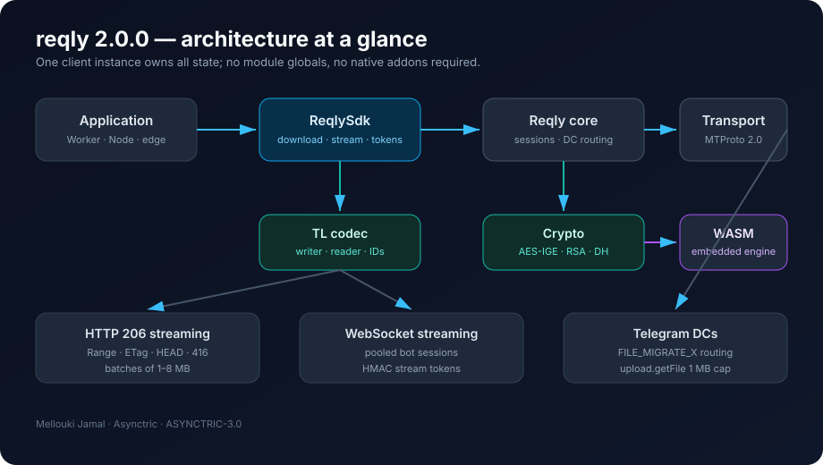

# reqlyproto (`reqly`)

[](https://www.npmjs.com/package/reqlyproto)
[](https://github.com/JamalMellouki/reqly-mtproto/releases)
[](https://github.com/JamalMellouki/reqly-mtproto/actions/workflows/ci.yml)
[](./LICENSE)
[](https://www.typescriptlang.org/)
[](https://nodejs.org/)

`reqlyproto` is a small MTProto 2.0 request/reply client built for Cloudflare
Workers and other edge runtimes. The short name **`reqly`** refers to the same
package. It offers two transport modes:

- **Reusable connection** (default): one obfuscated WebSocket per DC, held for
  the lifetime of a `Reqly` instance, with multiple RPCs multiplexed over it.
- **Fresh socket per RPC** (`freshSocket: true`): one short-lived WebSocket per
  call, for workloads that prefer fully stateless isolation.

Both modes keep all state inside the client instance — nothing is module-global.

- Version: **2.0.0** ([browse releases](https://github.com/JamalMellouki/reqly-mtproto/releases))
- Package: **reqlyproto** (short name: **reqly**)
- Author: **Mellouki Jamal**
- Platform: **Asynctric**
- License: **ASYNCTRIC-3.0** (permissive open source; author and platform
  identity must be preserved in copies and derivatives)

## Why reqly

Full MTProto clients were written for long-running processes. They keep sockets,
update loops and connection pools alive, and drag large TL schema maps into the
bundle. On a Workers isolate that means slow cold starts and high CPU usage.

reqly keeps only what file access requires:

- session parsing (gramJS `StringSession` v1),
- MTProto 2.0 message encryption and key derivation,
- obfuscated WebSocket transport using the abridged protocol,
- a small TL codec for method calls and file replies.

No runtime dependencies. No native modules. No state between requests.

## Features at a glance

| | |
|---|---|
| **⚡ Edge-native**<br>Zero runtime dependencies, no native modules, per-instance state. Safe for concurrent Workers. | **🔁 Two transports**<br>Reusable multiplexed connection per DC, or a fresh socket per RPC for stateless isolation. |
| **📦 Range streaming**<br>`Range`, `206`, `Content-Range`, `ETag`, `HEAD`, `416`. Batched 1–8 MB responses with adaptive 2→4 workers. | **🧭 Cross-DC ready**<br>Full in-house RSA/DH auth-key exchange; `FILE_MIGRATE_X` retries on the correct DC. |
| **🔐 Signed stream tokens**<br>Short-lived HMAC-SHA256 tokens for Worker-to-Worker streams. | **🧩 Pluggable crypto**<br>Pure TypeScript AES-256-IGE by default, embedded WASM backend, custom provider hook. |
| **🪙 High-level SDK**<br>`ReqlySdk.download()`, `.range()`, `.stream()`, `.hashes()` and `.worker()` in one import. | **🧪 Measured, not estimated**<br>Reproducible benchmark + real device numbers in `docs/BENCHMARKS.md`. |



## Versions / الإصدارات

| Version | Status | Best for |
| --- | --- | --- |
| **v2.0.0** | ✅ Latest | Streaming, SDK, embedded WASM, tokens, cross-DC |
| **v1.0.0** | ♻️ Preserved (legacy) | Minimal original request/reply client |

Both are immutable [GitHub releases](https://github.com/JamalMellouki/reqly-mtproto/releases),
so you can pin whichever fits your workload. Full history: [`CHANGELOG.md`](./CHANGELOG.md).

## Install

```sh
npm install reqlyproto
```

## Quick start

```ts
import { Reqly, TlWriter } from "reqlyproto"

const client = await Reqly.connect(env.MT_SESSION)

// Any MTProto method can be invoked by writing its constructor id and fields.
const config = await client.invoke(new TlWriter().uint(0xc4f9186b).result())
```

### Download a Telegram file

```ts
import { Reqly } from "reqlyproto"

const client = await Reqly.connect(sessionString)

// Prefer the typed helper — it handles 4 KB/1 MB alignment, file references,
// DC migration and EOF for you:
const bytes = await client.getFile(
  { id, accessHash, fileReference, size },
  offset,
  limit,
)

// Or invoke any method with raw TL bytes:
// const reply = await client.invoke(new TlWriter().uint(0xc4f9186b).result())
```

## SDK (recommended)

`reqlyproto` ships a high-level SDK — no second package to install:

```ts
import { createReqlySdk, ReqlySdk } from "reqlyproto"

const sdk = await createReqlySdk({
  session: MT_SESSION,          // Worker secret — never source code
  dcSessions: DC_SESSIONS,      // optional, for FILE_MIGRATE_X
  tokenSecret: STREAM_SECRET,   // optional, for issueToken()/verifyToken()
})

const bytes = await sdk.download(document, { onProgress: (done, total) => {} })
const stream = sdk.stream(document, { chunkSize: 512 * 1024 })
const hashes = await sdk.hashes(document)
const token = await sdk.issueToken({ d: String(document.id), o: 0, l: bytes.length }, 60)

sdk.close()
```

See [`docs/SDK.md`](./docs/SDK.md) for the full guide (ranges, cache keys,
Worker handler, backpressure and closing), and
[`docs/showcase/index.html`](./docs/showcase/index.html) for an interactive,
offline-safe demo of streaming, scroll-to-seek, measured numbers, SVG and
Mermaid diagrams.

## API

| Export | Purpose |
| --- | --- |
| `createReqlySdk(options)` / `ReqlySdk` | High-level download, range, stream, hashes, tokens and Worker handler |
| `ReqlySdk.cacheKey(document, offset, length)` | Stable, reference-safe cache key for a document range |
| `Reqly.connect(session, options?)` | Parse a session and create a client |
| `client.invoke(methodBytes)` | Send one raw TL method and return its result bytes |
| `client.getMessages(channelId, accessHash, ids)` | Resolve document references from a channel |
| `client.getFile(document, offset, limit)` | Download a file slice (block-aligned, EOF-safe) |
| `client.getFilesParallel(document, ranges, options?)` | Adaptive parallel pool (2→4 workers, backoff on failure) |
| `client.getFileHashes(document, offset?, refresh?)` | `upload.getFileHashes` with reference refresh and DC migration |
| `getFileHashes(client, document, offset?, refresh?)` | Standalone helper (primary DC only) |
| `ChunkReader` / `createChunkReader` | Cached, block-aligned range reader with prefetch |
| `client.close()` | Close all reusable connections |
| `Connection` | Low-level reusable MTProto connection |
| `SessionStore` | Per-DC session registry |
| `parseSession(encoded)` | Parse a gramJS v1 StringSession |
| `TlWriter`, `TlReader` | Minimal Type Language codec |
| `extractDocuments`, `decodeFile` | Helpers for Telegram replies |
| `setIgeProvider(provider)` | Replace the built-in AES-256-IGE implementation |
| `deriveKeys`, `messageKeyOf`, `ctrTransform` | Protocol primitives for advanced use |

### One-call Cloudflare Worker

```ts
import { createWorkerHandler } from "reqlyproto"

export default createWorkerHandler({
  session: MT_SESSION,
  connectOptions: { dcSessions: DC_SESSIONS },
  resolveDocument: () => document,
  batchChunks: 8,      // 8 x 1 MB = 8 MB per response
  maxWorkers: 4,       // parallel 1 MB Telegram reads
  cpuBudgetMs: 4,      // adaptive batch sizing for a strict CPU cap
})
```

The handler adds `Range`, `206`, `Content-Range`, `Accept-Ranges`, `ETag`,
`HEAD` and `416` itself. For lower-level control use `streamFileRange`,
`createFileResponse` or `createFileRequestHandler`. See
`docs/PERFORMANCE.md` for measured limits.

### Options

- `apiId` — your Telegram API id from my.telegram.org (defaults to `1`; not validated for read-only calls)
- `dcSessions` — map of `dcId → StringSession` for `FILE_MIGRATE_X` retries
- `freshSocket` — `true` opens one WebSocket per RPC; `false` (default) reuses a connection
- `timeoutMs` — RPC timeout
- `address`, `port` — override the DC endpoint from the session

## Error handling

Documented Telegram file errors are surfaced as typed exceptions:

- `FileReferenceExpiredError` — refresh the reference via `channels.getMessages`
  and pass a refresh callback to `getFile`:

  ```ts
  const bytes = await client.getFile(location, offset, limit, async () => {
    const [document] = await client.getMessages(channelId, accessHash, [messageId])
    return document
  })
  ```

- `FileMigrateError` — exposes `dcId` from `FILE_MIGRATE_X`. Pass one authorized
  session per DC via `Reqly.connect(session, { dcSessions: { 1: str, 2: str } })`
  and `getFile` retries on the correct DC automatically.

### Data centers and authorization transfer

A file's `auth_key` cannot be reused on another DC, so `FILE_MIGRATE_X`
requires a fresh, authorized session for that DC. `reqly` implements the whole
MTProto 2.0 auth-key exchange itself — no other MTProto library is involved:

- `src/dh.ts` — plaintext wire format (`req_pq_multi`, `resPQ`, pq factorization,
  `req_DH_params`, `server_DH_inner_data`, `set_client_DH_params`, `dh_gen_ok`).
- `src/handshake.ts` — RSA_PAD, temporary AES, DH math, key derivation.
- `src/rsa.ts` — the official production RSA public keys, fingerprint-verified.

The expensive RSA/DH work runs **once in Node**, never inside the 10 ms Worker:

```sh
tsx scripts/gen-dc-sessions.ts   # prints DC1_SESSION / DC2_SESSION / DC3_SESSION
```

For each DC the script performs the full handshake on the DC's raw TCP address,
serializes the fresh key into a gramJS-compatible StringSession, exports the bot
authorization from the home DC and imports it on the new key. The resulting
strings are injected with `Reqly.connect(session, { dcSessions })` and stored in
`SessionStore`; `getFile` then retries on the correct DC automatically.

All steps are regression-guarded by `tests/dh.test.ts`, `tests/handshake.test.ts`,
`tests/handshake-wire.test.ts` (documented vectors) and `tests/rsa-key.test.ts`.
`tests/migrate-live.test.ts` verifies cross-DC downloads end to end when
`REQLY_LIVE_TEST=1`.

- Other errors are `RpcError` with the numeric Telegram code.

### File verification and streaming

`client.getFileHashes()` follows `FILE_MIGRATE_X` when the target DC session was
supplied through `dcSessions`, and accepts the same refresh callback as `getFile`.
The standalone `getFileHashes()` helper always uses the primary session: Telegram
answers `LOCATION_INVALID` when the document lives on another DC, so prefer the
client method for migrated files. The request offset is encoded as a TL `long`.

```ts
const entries = await client.getFileHashes(document, 0, refresh)
const bytes = await client.getFile(document, entries[0].offset, entries[0].limit)
console.log(await verifyChunk(bytes, entries[0]))
```

`ChunkReader.readRange(start, end)` returns exactly `end - start + 1` bytes (or
fewer at EOF). It trims both the leading block skip and the trailing bytes of the
last fetched chunk. Cache keys include the chunk size, `access_hash` and
`file_reference`, so a refreshed document reference cannot reuse stale bytes. A
short response is cached only when it reaches the declared end-of-file; short
reads in the middle of a file are discarded. `prefetchTail(0)` is a no-op and
`prefetchAhead` clamps negative positions to zero.

`parseSession` rejects sessions with an out-of-range DC, an empty address or port
zero before a socket is opened. `getFile` and `getFileHashes` reject negative or
non-integer offsets/limits, clamp reads to `location.size`, and `getMessages([])`
returns an empty list without an RPC. `close()` clears the initialized-DC flags, so a reopened connection repeats
`initWithLayer`.

CDN redirects (`upload.fileCdnRedirect`) are not handled by this version.
`upload.getFile` is sent with `cdn_supported` unset, so a master DC returns
`upload.file` directly. If a DC chooses to redirect, handle the redirect at the
application layer or open an issue.

### Throughput on Workers

Telegram allows at most 1 MB per `upload.getFile` call. The default crypto
backend is pure TypeScript and needs no external asset. On runtimes where CPU
time is tight, an application may supply its own compiled AES-256-IGE WebAssembly
module at startup:

```ts
import { enableWasmCrypto } from "reqlyproto"

// `aesWasmModule` is a WebAssembly.Module provided by the application.
enableWasmCrypto(aesWasmModule)
```

A prebuilt AES-256-IGE WASM module is bundled in `dist/aes-ige.wasm` and is
loaded automatically when available; applications may still provide their own
module through `enableWasmCrypto()`.

1 MB per `upload.getFile` call is a protocol hard limit. An application can
aggregate several calls into one HTTP response (e.g. 2–8 MB) to reduce the
number of HTTP requests; a 2 GB file at 8 MB per response needs about 250
requests — roughly **0.25%** of the free 100,000 requests/day. Repeat ranges can
be served from Cloudflare's Cache API without contacting Telegram. These figures
are planning estimates, not benchmarks.

`msg_id` counters are per client instance, never module-global, so concurrent
Workers invocations cannot collide.

## Security

The session string contains a 2048-bit authorization key. Treat it as a
password: store it as a Worker secret, never in source control or a URL.

`reqly` never exposes the session, the auth key, or Telegram cookies to callers.
Transport errors and Telegram RPC errors are surfaced as ordinary exceptions.

## Extending the crypto backend

The built-in AES-256-IGE implementation is pure TypeScript and passes the
FIPS-197 AES-256 vector. Platforms that can compile WebAssembly at build time
may register a faster provider:

```ts
import { setIgeProvider } from "reqlyproto"

setIgeProvider({
  encrypt: (data, key, iv) => /* AES-256-IGE encrypt */,
  decrypt: (data, key, iv) => /* AES-256-IGE decrypt */,
})
```

## Documentation

- [`CHANGELOG.md`](./CHANGELOG.md) — complete release history (v1.0.0 preserved, v2.0.0 current)
- [`docs/SDK.md`](./docs/SDK.md) — SDK guide: download, range, stream, tokens, Worker handler
- [`docs/ARCHITECTURE.md`](./docs/ARCHITECTURE.md) — SVG + Mermaid diagrams, trust boundaries
- [`docs/BENCHMARKS.md`](./docs/BENCHMARKS.md) — reproducible measurements and raw JSON
- [`docs/PERFORMANCE.md`](./docs/PERFORMANCE.md) — deployed Worker CPU model and limits
- [`docs/showcase/index.html`](./docs/showcase/index.html) — interactive, offline-safe demo

## Development

```sh
npm install
npm run build
npm test
```

Unit tests cover AES, MTProto key derivation, session parsing and the TL codec.
A live Telegram test is available but skipped by default:

```sh
REQLY_LIVE_TEST=1 REQLY_SESSION="<your StringSession>" npm test
```

Optional live variables:

- `REQLY_SESSION` — required for all live tests
- `REQLY_DOCUMENT` — JSON with `id`, `accessHash`, `fileReference` (hex), `size`
- `REQLY_DC1_SESSION` … `REQLY_DC5_SESSION` — sessions for cross-DC tests
- `REQLY_MIGRATED_DOCUMENTS` — JSON array of documents for the migration test

## License

ASYNCTRIC-3.0. Free for personal and commercial use, modification and
redistribution, provided the author **Mellouki Jamal** and platform
**Asynctric** identities remain in the source and documentation. Version 3.0
adds an explicit no-warranty and limitation-of-liability clause. See `LICENSE`.

---

Made by Mellouki Jamal for Asynctric.
