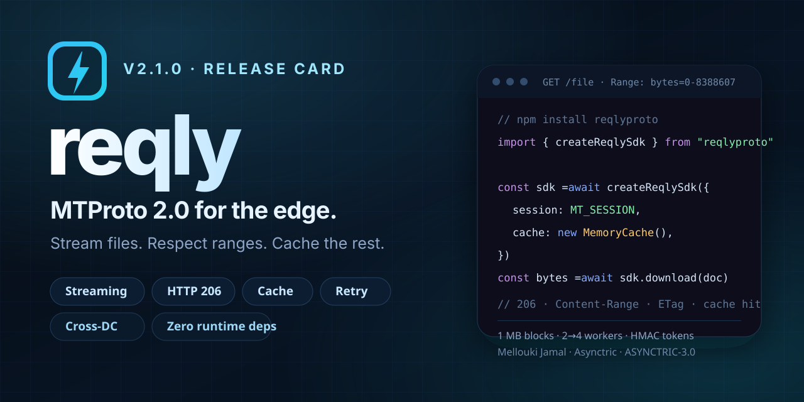

<div align="center">


**A tiny MTProto 2.0 request/reply client for Cloudflare Workers and edge runtimes.**

[](https://www.npmjs.com/package/reqlyproto)
[](https://www.npmjs.com/package/reqlyproto)
[](https://github.com/JamalMellouki/reqly-mtproto/releases)
[](https://github.com/JamalMellouki/reqly-mtproto/actions/workflows/ci.yml)
[](./LICENSE)
[](./package.json)
[](https://www.typescriptlang.org/)
[](https://nodejs.org/)

[Quick start](#-quick-start) · [SDK](#-high-level-sdk) · [Cache & retry](#-cache--retry) · [Worker](#-one-call-worker) · [Docs](#-documentation) · [العربية](./README.ar.md)

</div>



> **v2.1.0 — cache, resilience and a clearer path.**
> The same tiny client, now with a reference-safe byte cache, a first-class
> retry policy, a fixed refresh flow in `sdk.download()`, and a documentation
> set that takes you from a session string to a deployed range-capable Worker.

## Contents

- [What's new in 2.1.0](#-whats-new-in-210)
- [Why reqly](#-why-reqly)
- [Features at a glance](#-features-at-a-glance)
- [Architecture](#-architecture)
- [Install](#-install)
- [Quick start](#-quick-start)
- [High-level SDK](#-high-level-sdk)
- [Cache & retry](#-cache--retry)
- [One-call Worker](#-one-call-worker)
- [API reference](#-api-reference)
- [Errors](#-errors)
- [Cross-DC downloads](#-cross-dc-downloads)
- [Performance](#-performance)
- [Security](#-security)
- [Documentation](#-documentation)
- [Development](#-development)
- [License](#-license)

## ✨ What's new in 2.1.0

| | |
|---|---|
| **🧠 `MemoryCache`**<br>A byte-budgeted LRU with TTL, counters and copy-safe reads. No dependencies, works in Node, Workers and tests. | **🌐 `createCacheApiStore()`**<br>Adapts the standard `Cache` API to the SDK cache contract in one line, for edge deployments. |
| **🔁 `withRetry()`**<br>Typed retry policy with exponential backoff, jitter, flood-wait absorption and abort support. | **🩹 SDK correctness**<br>`download()` now forwards `refresh`, reads through the cache, and reports monotonic progress. |
| **🌍 `sdk.worker()`**<br>Inherits the SDK session and connection options instead of starting from an empty session. | **🔑 Reference-safe keys**<br>`ReqlySdk.cacheKey()` fingerprints the `file_reference`, so stale bytes can never satisfy a refreshed document. |
| **📚 New guides**<br>Getting started, cookbook, API reference, FAQ and a security policy — plus a rebuilt interactive showcase. | **🖼️ New identity**<br>A proper logo and release card, a cleaner README, and consistent 2.1.0 reporting everywhere. |

## 🚀 Why reqly

Full MTProto clients were written for long-running processes. They keep sockets,
update loops and connection pools alive and drag large TL schema maps into the
bundle. On a Workers isolate that means slow cold starts and high CPU usage.

reqly keeps only what file access requires:

- session parsing (gramJS `StringSession` v1),
- MTProto 2.0 message encryption and key derivation,
- obfuscated WebSocket transport using the abridged protocol,
- a small TL codec for method calls and file replies,
- a range/HTTP layer that understands `206`, `Content-Range`, `ETag` and `HEAD`.

No runtime dependencies. No native modules. No state between requests.

## 🧩 Features at a glance

| | |
|---|---|
| **⚡ Edge-native**<br>Zero runtime dependencies, no native modules, per-instance state. Safe for concurrent Workers. | **🔁 Two transports**<br>Reusable multiplexed connection per DC, or a fresh socket per RPC for stateless isolation. |
| **📦 Range streaming**<br>`Range`, `206`, `Content-Range`, `ETag`, `HEAD`, `416`. Batched 1–8 MB responses with adaptive 2→4 workers. | **🧭 Cross-DC ready**<br>Full in-house RSA/DH auth-key exchange; `FILE_MIGRATE_X` retries on the correct DC. |
| **🔐 Signed stream tokens**<br>Short-lived HMAC-SHA256 tokens for Worker-to-Worker streams. | **🧩 Pluggable crypto**<br>Pure TypeScript AES-256-IGE by default, embedded WASM backend, custom provider hook. |
| **🪙 High-level SDK**<br>`download()`, `range()`, `stream()`, `hashes()` and `worker()` in one import. | **🧪 Measured, not estimated**<br>Reproducible benchmark + real device numbers in [`docs/BENCHMARKS.md`](./docs/BENCHMARKS.md). |
| **🧠 Byte cache**<br>LRU memory cache or the edge Cache API, keyed by reference and range. | **🔁 Retry policy**<br>Backoff, jitter, flood-wait handling and cancellation in one small helper. |

## 🏗️ Architecture


Every layer is replaceable and every piece of state lives inside a client
instance: `msg_id` counters, sessions and connections never become module
globals. See [`docs/ARCHITECTURE.md`](./docs/ARCHITECTURE.md) for diagrams and
trust boundaries.

## 📦 Install

```sh
npm install reqlyproto
```

The package is ESM, ships its own TypeScript declarations and has **zero
runtime dependencies**.

## ⚡ Quick start

```ts
import { Reqly, TlWriter } from "reqlyproto"

const client = await Reqly.connect(env.MT_SESSION)

// Any MTProto method can be invoked by writing its constructor id and fields.
const config = await client.invoke(new TlWriter().uint(0xc4f9186b).result())
```

### Download a Telegram file

```ts
import { Reqly } from "reqlyproto"

const client = await Reqly.connect(sessionString)

// Preferred: block alignment, file references, DC migration and EOF are handled.
const bytes = await client.getFile(
  { id, accessHash, fileReference, size },
  offset,
  limit,
)

client.close()
```

## 🪙 High-level SDK

`reqlyproto` ships a high-level SDK — no second package to install:

```ts
import { createReqlySdk, ReqlySdk } from "reqlyproto"

const sdk = await createReqlySdk({
  session: MT_SESSION,          // Worker secret — never source code
  dcSessions: DC_SESSIONS,      // optional, for FILE_MIGRATE_X
  tokenSecret: STREAM_SECRET,   // optional, for issueToken()/verifyToken()
})

const bytes = await sdk.download(document, { onProgress: (done, total) => {} })
const part  = await sdk.range(document, 0, 512 * 1024 - 1)
const stream = sdk.stream(document, { chunkSize: 512 * 1024 })
const hashes = await sdk.hashes(document)
const token = await sdk.issueToken({ m: messageId, w: "work-1", k: "stream" }, 60)

sdk.close()
```

The raw client is always one property away: `sdk.client.invoke(methodBytes)`.

See [`docs/SDK.md`](./docs/SDK.md) for ranges, cache keys, Worker handlers,
backpressure and closing.

## 🧠 Cache & retry

### Byte cache

```ts
import { createReqlySdk, MemoryCache, createCacheApiStore } from "reqlyproto"

// Node, tests or a long-lived process:
const cache = new MemoryCache({ maxBytes: 32 * 1024 * 1024, ttlSeconds: 3600 })

// Cloudflare Workers / browsers:
const edgeCache = createCacheApiStore(caches.default, 3600)

const sdk = await createReqlySdk({ session: MT_SESSION, cache: edgeCache })
const bytes = await sdk.download(document)   // second call is served from cache
```

Cache keys include the document id, access hash, **file-reference fingerprint**,
offset and length, so a refreshed reference can never reuse stale bytes.

Every block is cached only when it is complete; short reads in the middle of a
file are discarded instead of poisoning later seeks.

### Retry policy

```ts
import { withRetry, isRetryableError, DEFAULT_RETRY_POLICY } from "reqlyproto"

const entries = await withRetry(() => sdk.hashes(document), {
  retries: 3,
  baseDelayMs: 150,
  maxDelayMs: 4_000,
  jitter: 0.2,
  respectFloodWait: true,
  signal: request.signal,
})

isRetryableError(new Error("reqly: RPC timed out")) // true
isRetryableError(new Error("FILE_REFERENCE_EXPIRED")) // false — needs a refresh
```

Transient transport failures, `429` and `5xx` responses and flood waits are
retried. File-specific errors (`FILE_REFERENCE_EXPIRED`, `FILE_MIGRATE_X`) are
not blindly repeated: the client handles them with explicit flows.

## ☁️ One-call Worker

```ts
import { createWorkerHandler } from "reqlyproto"

export default createWorkerHandler({
  session: MT_SESSION,
  connectOptions: { dcSessions: DC_SESSIONS },
  resolveDocument: () => document,
  maxWorkers: 4,        // parallel 1 MB Telegram reads
  maxInFlight: 8,       // bounded lookahead
  cache: false,         // opt in only when cache subrequests are acceptable
})
```

The handler adds `Range`, `206`, `Content-Range`, `Accept-Ranges`, `ETag`,
`HEAD` and `416` itself. For lower-level control use `streamFileRange`,
`createFileResponse` or `createFileRequestHandler`. See
[`docs/PERFORMANCE.md`](./docs/PERFORMANCE.md) for measured limits.

### Options

| Option | Purpose |
| --- | --- |
| `apiId` | Telegram API id from my.telegram.org (defaults to `1`; not validated for read-only calls). |
| `dcSessions` | Map of `dcId → StringSession` for `FILE_MIGRATE_X` retries. |
| `freshSocket` | `true` opens one WebSocket per RPC; `false` (default) reuses a connection per DC. |
| `timeoutMs` | RPC timeout in milliseconds. |
| `address`, `port` | Override the DC endpoint from the session. |
| `cdnSupported` | Request `upload.fileCdnRedirect` when the DC offers it. |
| `cache` | Default `SdkCache` for `download`, `range` and `stream`. |
| `retry` | Default retry policy for helper calls and cache-aware block reads. |

## 📚 API reference

| Export | Purpose |
| --- | --- |
| `createReqlySdk(options)` / `ReqlySdk` | High-level download, range, stream, hashes, tokens and Worker handler |
| `ReqlySdk.cacheKey(document, offset, length)` | Reference-safe cache key for a document range |
| `MemoryCache` / `createCacheApiStore` | Ready-to-use byte caches (LRU memory and edge Cache API) |
| `withRetry` / `isRetryableError` / `retryDelayMs` | Retry policy, classification and bounded delays |
| `Reqly.connect(session, options?)` | Parse a session and create a client |
| `client.invoke(methodBytes)` | Send one raw TL method and return its result bytes |
| `client.getMessages(channelId, accessHash, ids)` | Resolve document references from a channel |
| `client.getFile(document, offset, limit, refresh?)` | Download a file slice (block-aligned, EOF-safe) |
| `client.getFilesParallel(document, ranges, options?)` | Adaptive parallel pool (2→4 workers, backoff on failure) |
| `client.getFileHashes(document, offset?, refresh?)` | `upload.getFileHashes` with reference refresh and DC migration |
| `getFileHashes(client, document, offset?, refresh?)` | Standalone helper (primary DC only) |
| `ChunkReader` / `createChunkReader` | Cached, block-aligned range reader with prefetch |
| `client.close()` | Close all reusable connections |
| `Connection` | Low-level reusable MTProto connection |
| `SessionStore` | Per-DC session registry |
| `parseSession(encoded)` | Parse a gramJS v1 StringSession |
| `TlWriter`, `TlReader` | Minimal Type Language codec |
| `extractDocuments`, `decodeFile` | Helpers for Telegram replies |
| `setIgeProvider(provider)` | Replace the built-in AES-256-IGE implementation |
| `deriveKeys`, `messageKeyOf`, `ctrTransform` | Protocol primitives for advanced use |

The complete surface is documented in [`docs/API.md`](./docs/API.md).

## ⚠️ Errors

Documented Telegram file errors are surfaced as typed exceptions:

- **`FileReferenceExpiredError`** — refresh the reference via
  `channels.getMessages` and pass a refresh callback to `getFile`:

  ```ts
  const bytes = await client.getFile(location, offset, limit, async () => {
    const [document] = await client.getMessages(channelId, accessHash, [messageId])
    return document
  })
  ```

- **`FileMigrateError`** — exposes `dcId` from `FILE_MIGRATE_X`. Pass one
  authorized session per DC via `Reqly.connect(session, { dcSessions })` and
  `getFile` retries on the correct DC automatically.
- **`FloodWaitError`** — exposes `seconds`; `withRetry` absorbs small waits.
- **`CdnRedirectError`** — exposes the redirect payload when `cdnSupported` is
  enabled.
- Other errors are `RpcError` with the numeric Telegram code.

## 🧭 Cross-DC downloads

A file's `auth_key` cannot be reused on another DC, so `FILE_MIGRATE_X`
requires a fresh, authorized session for that DC. `reqly` implements the whole
MTProto 2.0 auth-key exchange itself — no other MTProto library is involved:

- `src/dh.ts` — plaintext wire format (`req_pq_multi`, `resPQ`, pq factorization,
  `req_DH_params`, `server_DH_inner_data`, `set_client_DH_params`, `dh_gen_ok`).
- `src/handshake.ts` — RSA_PAD, temporary AES, DH math, key derivation.
- `src/rsa.ts` — the official production RSA public keys, fingerprint-verified.

The expensive RSA/DH work runs **once in Node**, never inside the 10 ms Worker:

```sh
tsx scripts/gen-dc-sessions.ts   # prints DC1_SESSION / DC2_SESSION / DC3_SESSION
```

For each DC the script performs the full handshake on the DC's raw TCP address,
serializes the fresh key into a gramJS-compatible StringSession, exports the bot
authorization from the home DC and imports it on the new key. The resulting
strings are injected with `Reqly.connect(session, { dcSessions })` and stored in
`SessionStore`; `getFile` then retries on the correct DC automatically.

Regression coverage lives in `tests/dh.test.ts`, `tests/handshake.test.ts`,
`tests/handshake-wire.test.ts` and `tests/rsa-key.test.ts`;
`tests/migrate-live.test.ts` verifies cross-DC downloads end to end when
`REQLY_LIVE_TEST=1`.

## 📈 Performance

Telegram allows at most 1 MB per `upload.getFile` call. The default crypto
backend is pure TypeScript and needs no external asset. On runtimes where CPU
time is tight, an application may supply its own compiled AES-256-IGE
WebAssembly module at startup:

```ts
import { enableWasmCrypto } from "reqlyproto"
enableWasmCrypto(aesWasmModule)   // optional: a prebuilt module ships in dist/
```

A prebuilt AES-256-IGE WASM module is bundled in `dist/aes-ige.wasm` and is
loaded automatically when available; applications may still provide their own
module through `enableWasmCrypto()`.

1 MB per `upload.getFile` call is a protocol hard limit. An application can
aggregate several calls into one HTTP response (e.g. 2–8 MB) to reduce the
number of HTTP requests; a 2 GB file at 8 MB per response needs about 250
requests — roughly **0.25%** of the free 100,000 requests/day. Repeat ranges can
be served from the Cache API without contacting Telegram. These figures are
planning estimates; measured numbers are in
[`docs/BENCHMARKS.md`](./docs/BENCHMARKS.md).

`msg_id` counters are per client instance, never module-global, so concurrent
Workers invocations cannot collide.

## 🔐 Security

The session string contains a 2048-bit authorization key. Treat it as a
password: store it as a Worker secret, never in source control or a URL.

`reqly` never exposes the session, the auth key, or Telegram cookies to callers.
Transport errors and Telegram RPC errors are surfaced as ordinary exceptions.
Stream tokens are HMAC-SHA256 signed and short-lived. All examples read secrets
from environment bindings.

See [`SECURITY.md`](./SECURITY.md) for the disclosure policy and the secret
handling checklist.

## 🗂️ Documentation

- [`docs/GETTING_STARTED.md`](./docs/GETTING_STARTED.md) — from a session string to your first download and Worker
- [`docs/SDK.md`](./docs/SDK.md) — SDK guide: download, range, stream, cache, retry, tokens, Worker handler
- [`docs/COOKBOOK.md`](./docs/COOKBOOK.md) — practical recipes for common edge workloads
- [`docs/API.md`](./docs/API.md) — export-by-export reference
- [`docs/ARCHITECTURE.md`](./docs/ARCHITECTURE.md) — SVG + Mermaid diagrams, trust boundaries
- [`docs/BENCHMARKS.md`](./docs/BENCHMARKS.md) — reproducible measurements and raw JSON
- [`docs/PERFORMANCE.md`](./docs/PERFORMANCE.md) — deployed Worker CPU model and limits
- [`docs/FAQ.md`](./docs/FAQ.md) — short answers to recurring questions
- [`docs/showcase/index.html`](./docs/showcase/index.html) — interactive, offline-safe demo
- [`docs/RELEASE_2.1.0.md`](./docs/RELEASE_2.1.0.md) — the 2.1.0 release presentation
- [`CHANGELOG.md`](./CHANGELOG.md) — complete release history

## 🛠️ Development

```sh
npm install
npm run build
npm test
```

Unit tests cover AES, MTProto key derivation, session parsing, the TL codec,
range streaming, caches and retries. A live Telegram test is available but
skipped by default:

```sh
REQLY_LIVE_TEST=1 REQLY_SESSION="<your StringSession>" npm test
```

Optional live variables:

- `REQLY_SESSION` — required for all live tests
- `REQLY_DOCUMENT` — JSON with `id`, `accessHash`, `fileReference` (hex), `size`
- `REQLY_DC1_SESSION` … `REQLY_DC5_SESSION` — sessions for cross-DC tests
- `REQLY_MIGRATED_DOCUMENTS` — JSON array of documents for the migration test

## 📄 License

ASYNCTRIC-3.0. Free for personal and commercial use, modification and
redistribution, provided the author **Mellouki Jamal** and platform
**Asynctric** identities remain in the source and documentation. Version 3.0
adds an explicit no-warranty and limitation-of-liability clause. See [`LICENSE`](./LICENSE).

---

<div align="center">

**Made by Mellouki Jamal for Asynctric.**

`reqly` · `reqlyproto` · version **2.1.0**

</div>
