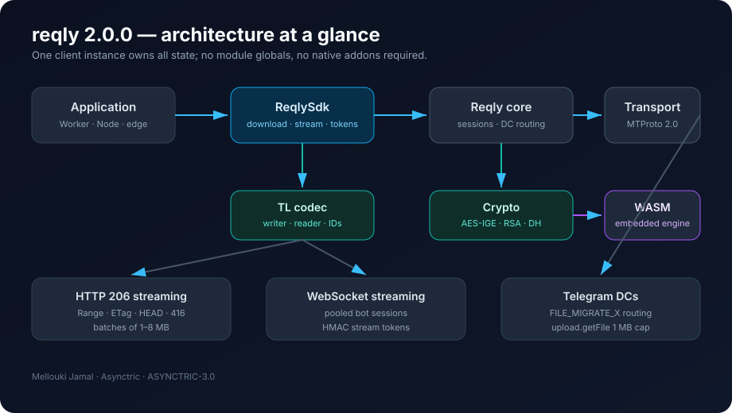
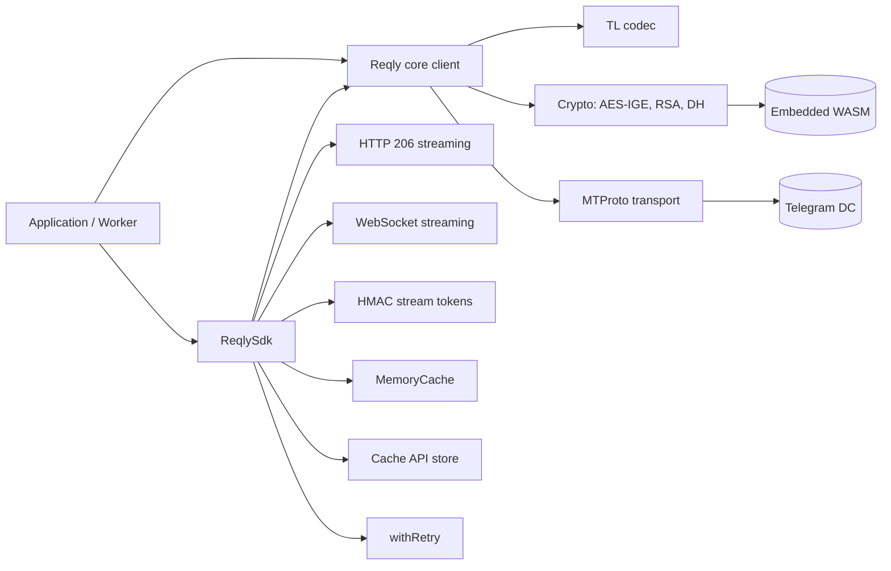
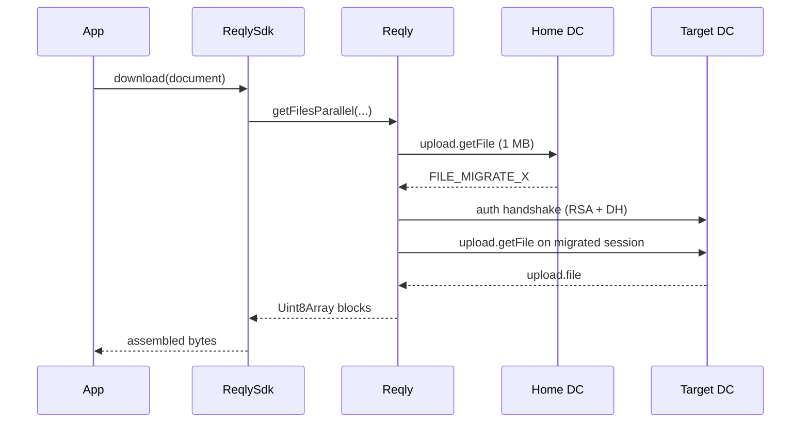
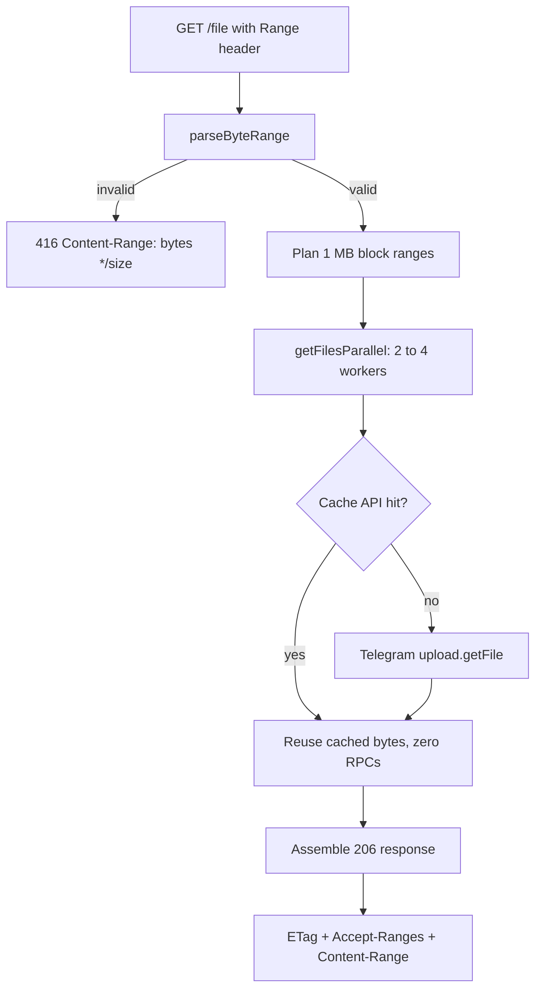
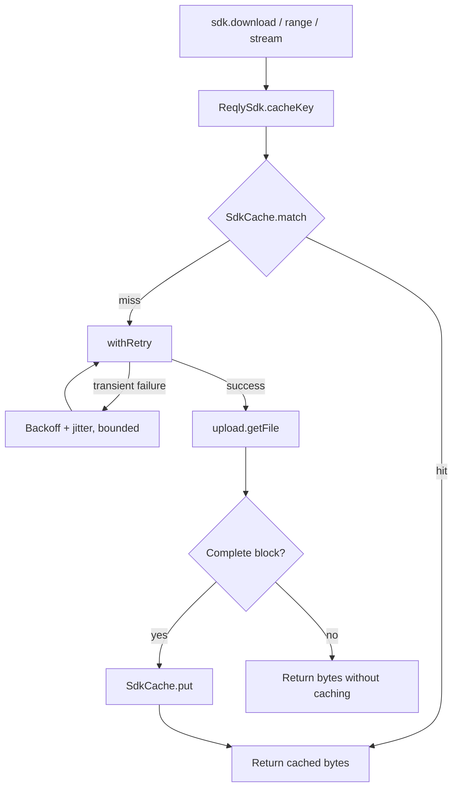

# reqly 2.1.0 — architecture

reqly is deliberately small. There is no runtime dependency, no native addon
requirement and no module-global state: every `msg_id` counter, session and
connection lives inside a client instance. This is what makes concurrent Workers
invocations safe.

## Layers

## Cross-DC file download

`FILE_MIGRATE_X` means the file lives on another data center and its `auth_key`
cannot be reused there. reqly performs the full MTProto 2.0 handshake itself —
`req_pq_multi`, pq factorization, `req_DH_params`, RSA_PAD, DH key derivation —
then imports the bot authorization into the new session.

## HTTP streaming path

## Cache and retry path

The cache is always correctness-first: the key includes the `file_reference`
fingerprint, and a short read is never stored. Retry never repeats
`FILE_REFERENCE_EXPIRED` or `FILE_MIGRATE_X`; those follow explicit refresh and
DC-migration flows.

## Trust boundaries

- Session strings and auth keys never leave the process; they are constructor
  inputs, not exported values.
- Stream tokens are HMAC-SHA256 signed with an application secret and carry an
  expiry (`e`). The SDK never logs them.
- `docs/showcase/index.html` is a static demo. It uses synthetic data only — it
  contains no credentials and makes no Telegram requests.

## Where to look next

| Topic | File |
| --- | --- |
| High-level API | [`SDK.md`](./SDK.md) |
| Measured performance | [`BENCHMARKS.md`](./BENCHMARKS.md) |
| Worker CPU model | [`PERFORMANCE.md`](./PERFORMANCE.md) |
| Release history | [`CHANGELOG.md`](../CHANGELOG.md) |
| Interactive demo | [`showcase/index.html`](./showcase/index.html) |
