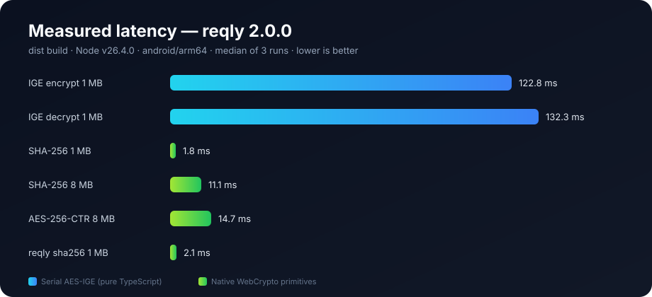

# reqly 2.1.0 — measured benchmarks

These are **real measurements**, not estimates. They were produced by
[`scripts/bench.mjs`](../scripts/bench.mjs) against the shipped `dist/` build,
with no network calls and no credentials. Raw output is committed as
[`benchmark-results.json`](./benchmark-results.json) so every number below can
be reproduced:

```sh
npm run build
node --experimental-loader ./scripts/esm-resolve.mjs scripts/bench.mjs
```

Environment: **Node v26.4.0 · android/arm64 · median of 3 runs**.



## Crypto and native primitives

| Operation | Median | Throughput | Note |
| --- | ---: | ---: | --- |
| AES-256-IGE encrypt 1 MB | 88.3 ms | 11.9 MB/s | pure TypeScript, serially dependent blocks |
| AES-256-IGE decrypt 1 MB | 96.9 ms | 10.8 MB/s | pure TypeScript, serially dependent blocks |
| SHA-256 1 MB (`crypto.subtle`) | 2.9 ms | 358.9 MB/s | native WebCrypto |
| SHA-256 8 MB (`crypto.subtle`) | 16.5 ms | 507.8 MB/s | native WebCrypto |
| AES-256-CTR 8 MB (`crypto.subtle`) | 19.2 ms | 436.6 MB/s | native, parallelizable (CDN path) |
| `sha256()` helper 1 MB | 3.1 ms | 339.2 MB/s | reqly wrapper over WebCrypto |

**Reading the numbers.** IGE is *provably serial*: each plaintext block depends
on the previous ciphertext block, so WebCrypto cannot batch it. That is why the
first two rows are roughly 30× slower than native hashing. The embedded WASM
backend (`dist/aes-ige.wasm`) closes part of this gap; the CDN path
(AES-256-CTR) is the only route to native-speed large ranges.

## Codec, tokens and range parsing

| Operation | Median |
| --- | ---: |
| TL encode one method call | 20.4 µs |
| TL decode one method call | 5.5 µs |
| `createStreamToken()` (HMAC-SHA256) | 1.8 ms |
| `verifyStreamToken()` | 1.4 ms |
| `parseByteRange("bytes=0-8388607")` | 1.8 µs |

Token and codec costs are negligible next to a 1 MB block read. Range parsing
is effectively free — it is a pure string operation.

## Cache and retry overhead (new in 2.1.0)

| Operation | Median | Throughput |
| --- | ---: | ---: |
| `MemoryCache.put()` 1 MB | 422.8 µs | 2480.3 MB/s |
| `MemoryCache.match()` 1 MB | 324.0 µs | 3236.3 MB/s |
| `withRetry()` immediate success | 0.7 µs | — |

Both cache operations copy the block, so the measured cost includes the copy
that keeps callers from mutating cached bytes. Compared with an 88–97 ms IGE
decryption, a cache hit is effectively free; the network RPC it replaces is
measured in hundreds of milliseconds.

## Worker budget model (from live deployment notes)

`docs/PERFORMANCE.md` records the deployed-Worker findings that complement this
local benchmark:

| Scenario | Observed |
| --- | --- |
| `/stream` 8 MB in 8 parallel 1 MB blocks | success, exactly 8,388,608 bytes |
| Same payload hashed inside the Worker | 503 / CPU budget exhausted (1102) |
| `Range: bytes=0-41943039` (40 MB) | not achievable with the pure-JS engine |

Consequence: streaming never hashes the body; hash verification is opt-in and
fed from `upload.getFileHashes`. A 2 GB file needs ~256 Worker invocations at
8 MB per response — about 0.25% of a 100,000 requests/day allowance.

## Reproducibility and honesty

- Run the benchmark on your own device; numbers will differ with CPU and runtime.
- The benchmark writes only `docs/benchmark-results.json` and prints to stdout.
- No session string, bot token, API hash or environment secret is read anywhere
  in the script.
- Deployment measurements in `PERFORMANCE.md` are labelled separately from
  local microbenchmarks; neither is presented as the other.
