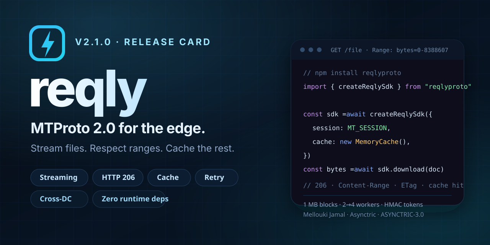

**reqly 2.1.0 — cache, resilience and polished docs.**

The same small MTProto 2.0 client, now with a reference-safe byte cache, a
first-class retry policy, corrected SDK refresh behaviour, HTTP `304` support,
and a documentation set that takes you from a session string to a deployed
range-capable Worker.

---

## Highlights

### 🧠 A byte cache that cannot serve stale bytes

- **`MemoryCache`** — LRU with a hard `maxBytes` budget, per-entry TTL,
  copy-safe reads and `hits` / `misses` / `evictions` / `bytes` counters.
- **`createCacheApiStore(caches.default)`** — the standard edge Cache API adapted
  to the SDK contract in one line.
- **Reference-safe keys** — `ReqlySdk.cacheKey()` includes a hex fingerprint of
  `file_reference`, so a refreshed document can never reuse bytes fetched under
  an expired reference.
- **Correctness first** — only complete blocks are cached; short reads in the
  middle of a file are discarded.

### 🔁 Retry that knows what not to repeat

- **`withRetry()`** — exponential backoff, bounded jitter, small `FLOOD_WAIT_X`
  absorption and `AbortSignal` cancellation.
- **`isRetryableError()`** — retries transport failures, `429` and `5xx`; never
  blindly repeats `FILE_REFERENCE_EXPIRED` or `FILE_MIGRATE_X`.
- **SDK integration** — `cache` and `retry` defaults on `createReqlySdk`, plus
  per-call overrides on `download`, `range` and `stream`.

### 🩹 SDK correctness fixes

- `sdk.download()` **forwards `refresh`** to every block read instead of dropping
  it, and reports **monotonic progress** even when the pool resolves blocks out
  of order.
- `sdk.worker()` now **inherits the SDK session and connection options** instead
  of starting from an empty session.
- `sdk.hashes()` accepts a refresh callback.
- `createFileResponse()` and the Worker handler answer **`If-None-Match` with
  `304`**, alongside `Range`, `206`, `Content-Range`, `ETag`, `If-Range`,
  `HEAD`, `416` and `405`.

### 📚 Documentation and identity

- New **Getting started**, **Cookbook**, **API reference**, **FAQ** and
  **Security policy**.
- Rebuilt **SDK guide** with the real `StreamTokenPayload` shape
  (`{ m, w, e, k }`), cache keys, retry policy and Worker defaults.
- Redesigned **English and Arabic READMEs**, a new logo, a release card and a
  rebuilt offline-safe showcase with interactive cache and retry demos.
- Updated **benchmarks** with reproducible cache/retry measurements.

## Upgrade

```sh
npm install reqlyproto@2.1.0
```

No breaking API changes from 2.0.0. The new cache and retry features are opt-in;
existing 2.0.0 code keeps working. `batchChunks`, `workers` and `cpuBudgetMs`
remain accepted where they were, but `maxWorkers` and `maxInFlight` are the
documented names.

## Documentation

- [CHANGELOG](https://github.com/JamalMellouki/reqly-mtproto/blob/v2.1.0/CHANGELOG.md)
  — complete history
- [Getting started](https://github.com/JamalMellouki/reqly-mtproto/blob/v2.1.0/docs/GETTING_STARTED.md)
  — session string → first download → deployed Worker
- [SDK guide](https://github.com/JamalMellouki/reqly-mtproto/blob/v2.1.0/docs/SDK.md)
  — cache, retry, ranges, tokens and handlers
- [Cookbook](https://github.com/JamalMellouki/reqly-mtproto/blob/v2.1.0/docs/COOKBOOK.md)
  — twelve practical recipes
- [API reference](https://github.com/JamalMellouki/reqly-mtproto/blob/v2.1.0/docs/API.md)
  — every export, grouped by purpose
- [FAQ](https://github.com/JamalMellouki/reqly-mtproto/blob/v2.1.0/docs/FAQ.md)
- [Architecture](https://github.com/JamalMellouki/reqly-mtproto/blob/v2.1.0/docs/ARCHITECTURE.md)
- [Benchmarks](https://github.com/JamalMellouki/reqly-mtproto/blob/v2.1.0/docs/BENCHMARKS.md)
- [Showcase](https://github.com/JamalMellouki/reqly-mtproto/blob/v2.1.0/docs/showcase/index.html)
- [Security policy](https://github.com/JamalMellouki/reqly-mtproto/blob/v2.1.0/SECURITY.md)

## Install

```sh
npm install reqlyproto@2.1.0
```

```ts
import { createReqlySdk, MemoryCache, withRetry } from "reqlyproto"

const sdk = await createReqlySdk({
  session: MT_SESSION,
  cache: new MemoryCache({ maxBytes: 64 * 1024 * 1024 }),
})

const bytes = await sdk.download(document)
const entries = await withRetry(() => sdk.hashes(document), { retries: 3 })
sdk.close()
```

Zero runtime dependencies. ESM. TypeScript declarations included.

---

Mellouki Jamal — Asynctric · ASYNCTRIC-3.0
